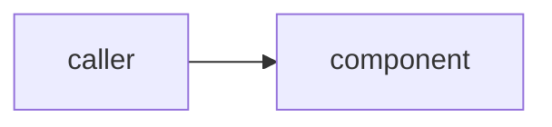

# COMPONENT

## Purpose

<!-- One paragraph: what this component is for, in the present tense. -->

## Structure

<!-- Internal modules at module level. No per-function detail. -->

| Module | Role         |
| ------ | ------------ |
| `mod`  | what it does |

## Public API

<!-- Items exported at the component root or entry point, at most 25 rows. Link generated API docs for the rest. -->

| Item   | What it does |
| ------ | ------------ |
| `Item` | what it does |

## Interactions

<!-- What it calls and exposes: files, sockets, processes, env. `depends-on` carries the internal edges. -->

## Flow

## Decisions

<!-- Decisions in force, current state only. Delete a bullet when it stops being true. -->

- **Decision.** Reason.
