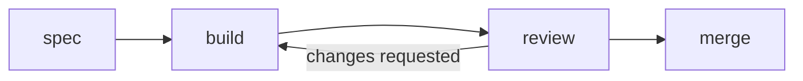

# PROJECT process

One paragraph: which procedure the project runs, in present tense. `procedure` in the frontmatter
is the file name of `.agents/procedures/PROCEDURE-NAME.md`, without the extension. Do not copy the
procedure here: name its stages and link it.

## Where the documents live

<!-- Keep only the rows the project has. -->

| Path                                   | Role                             |
| -------------------------------------- | -------------------------------- |
| `.agents/policy.md`                    | rules every procedure obeys      |
| `.agents/procedures/PROCEDURE-NAME.md` | the steps and gates              |
| `.agents/charter.md`                   | what the project is for          |
| `.agents/iterations/`                  | record of changes to the process |

## Who decides

The owner decides: <gates, merge rights, changes to the procedure>. An agent may change: <code, tests,
docs inside a change request>. An agent proposes changes to the process and does not apply them.

## Diagram

Mandatory: at least one mermaid view of the process (see `diagrams.md`). Pick the form that fits:
a flowchart for stages and gates, a state diagram if work items move through named states.

## Changes to the process

See [`.agents/iterations/`](../.agents/iterations/) for the record of changes.
