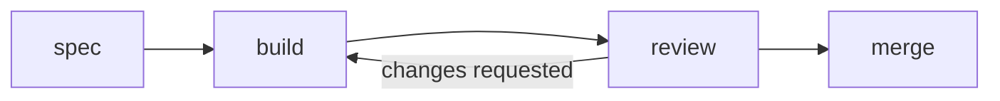

# PROJECT process

One paragraph: which workflows the project runs, in present tense. Do not copy a workflow here:
name its tasks and link its file.

## Where the documents live

<!-- Keep only the rows the project has. -->

| Path                           | Role                                  |
| ------------------------------ | ------------------------------------- |
| `.agents/policy.md`            | settings every workflow obeys         |
| `<organization root>/manifest` | the roles, workflows and floors       |
| `<workflow file>`              | the tasks, acceptance items and gates |

## Who decides

The owner decides: <gates, merge rights, changes to a workflow>. An agent may change: <code, tests,
docs inside a change request>. An agent proposes changes to the process and does not apply them.

## Diagram

Mandatory: at least one mermaid view of the process (see `diagrams.md`). Pick the form that fits:
a flowchart for stages and gates, a state diagram if work items move through named states.

