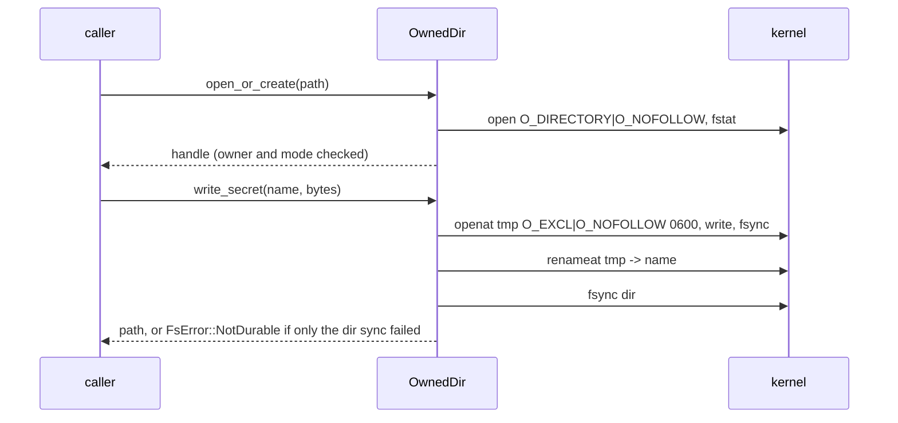

# Two-layer docs: format spec

Status: **proposed, not built.** [`contract.md`](contract.md) governs until phase P1 below lands. SKILL.md
does not link this file, so a session using the skill today does not act on it.

Covers Teebor-Choka/skills #107, #135 and #138. Extends [`contract.md`](contract.md),
[`flow.md`](flow.md), [`enforcement.md`](enforcement.md) and [`diagrams.md`](diagrams.md); it restates
none of them. Path rationale: `references/` is where the skill keeps its contract-level docs, and
the spec becomes contract text section by section as each phase lands, after which this file is
deleted.

## Layers and ownership

| Layer     | Docs                                                          | Authoring skill                    | Contract and enforcement |
| --------- | ------------------------------------------------------------- | ---------------------------------- | ------------------------ |
| Project   | `docs/overview.md`, `spec.md`, `process.md`, `decisions/`     | `design:project-docs`              | `design:project-docs`    |
| Component | `docs/components/<component>.md`, one page per component      | `swe:component-docs` (new)         | `design:project-docs`    |
| Generated | `docs/generated/architecture.md`, `docs/generated/index.html` | none (written by `render_docs.py`) | `design:project-docs`    |

- **`design:project-docs` stays in `design` under its current name** (resolves #135 and #138 without
  a move). It owns design records: the overview, the architecture and the ADRs, the same artefacts
  `architect` produces forward and this skill records as built. Sessions, hooks and other skills
  already invoke `design:project-docs`, so a move would break each caller for no gain in behaviour.
- **`swe:component-docs` is authoring only.** It explores code and writes component pages; it is
  engineering work done next to the code change, so it sits in `swe`. The component contract, the
  component resolver, the validator rules and the renderer stay in `project-docs`, which keeps one
  contract for both layers and the same authoring/enforcement split the skill already has.

## Definitions

- **Component**: a unit with a public API that the repo's manifests name as a buildable member: a
  Cargo workspace member, an npm/yarn workspace package, a uv workspace member or the single
  `pyproject.toml` package, a Go module in `go.work` or the single `go.mod`.
- **Component name**: the manifest's package name (`[package].name`, `package.json` `name`,
  `[project].name`, the last segment of the Go module path).
- **Internal dependency**: a normal (non-dev, non-build) dependency on another component of the same
  repo. Dev and build dependencies are excluded, so Cargo's acyclic rule holds for the graph.

## Valid inputs

1. **Repo with no `docs/components/`.** When `docs/components/` is absent, the validator and the
   renderer shall treat the component layer as not adopted and apply only today's contract, provided
   the repo resolves to at most one component or the policy key `docs.components.adopt` is `false`.
   If the repo resolves to two or more components and the key is unset, the validator shall emit
   `components-not-adopted` as a finding, so the layer cannot be skipped by omission.
2. **Single-component repo.** When the resolver finds exactly one component, the system shall
   require no component page; the project layer covers it. A page that exists anyway must conform.
3. **Component resolution.** When `components.py` runs on a repo, it shall resolve the component set
   from the manifests in "Definitions" using only the standard library (`tomllib`, `json`), expand
   workspace globs with `fnmatch` over directory names, honour Cargo `exclude`, and sort the result by
   codepoint of the POSIX relpath. Provided the policy key `docs.components.include` (a glob list) is
   set, it replaces manifest discovery; `docs.components.exclude` (a list of `name: reason` pairs)
   removes members. If the repo has a workspace format the resolver cannot parse with the stdlib
   (`pnpm-workspace.yaml`, Bazel, a Gradle multi-project), it shall HALT with `needs-input` (see
   "Failure definition"); it never guesses from the directory tree.
4. **Component page.** A file `docs/components/<name>.md`, where `<name>` is the component name with
   any character outside `[a-z0-9-]` replaced by `-`. Frontmatter is flat, parsed by the existing
   `split_frontmatter` (one-line `[a, b]` lists are supported).
5. **Changed-file set** (renderer trigger and `--pr-summary`). From `git diff --name-only <base>...HEAD`.
   `<base>` is `--base <ref>` when given (CI passes the PR base SHA); else the merge-base of `HEAD` and
   `@{upstream}`; else the merge-base with `origin/HEAD`. If none resolves, the run shall print
   `warning: trigger-skipped: no diff base` to stderr and continue; it never passes silently.

## Expected outputs

### Component page template

Frontmatter keys (all required):

| Key          | Value                                                                             |
| ------------ | --------------------------------------------------------------------------------- |
| `title`      | the component name                                                                |
| `kind`       | `component`                                                                       |
| `project`    | same value as every other doc in the project                                      |
| `updated`    | `YYYY-MM-DD`                                                                      |
| `component`  | the manifest package name, exactly                                                |
| `path`       | repo-relative POSIX dir of the manifest                                           |
| `depends-on` | `[a, b]` internal dependencies by component name, codepoint-sorted; `[]` for none |

Sections, as `##` headings in this order: **Purpose**, **Structure**, **Public API**,
**Interactions**, **Flow**, **Decisions**.

- **Purpose**: one paragraph. The renderer copies it.
- **Structure**: how the component is assembled, internal modules in a table (module, role). Stops at
  module level; no per-function detail ([`diagrams.md`](diagrams.md), two tracks).
- **Public API**: a table of the entry points a caller uses (item, what it does). Only items exported
  at the component's root or entry point, at most 25 rows; link generated API docs for the rest.
- **Interactions**: what it calls and what it exposes to the outside (files, sockets, processes,
  env). `depends-on` carries the internal edges; "used by" is never authored, the renderer derives it.
- **Flow**: the top-level flow through the component, as one mermaid block (`sequenceDiagram` or
  `flowchart`). Mandatory: at least one mermaid block on the page.
- **Decisions**: the worker's decisions in force, one per bullet, `**<decision>.** <reason>`. Current
  state only. When a decision stops being true, the author deletes the bullet; git history keeps the
  past. A rejected alternative stays as a footnote only while it still explains the current choice.
  A decision that binds more than this component moves to `docs/decisions/` as an ADR and the bullet
  links it.

Size: at most 200 lines and 12 KB including frontmatter; target under 100 lines.

### Worked example: `sandy-fsutil`

Facts taken from kauki-labs/sandy at commit `734b2a9a` (`crates/sandy-fsutil/src/{lib,secret}.rs`,
`Cargo.toml`). Its only dependencies are external (`getrandom`, `rustix`, `thiserror`), so
`depends-on` is empty.

````markdown
---
title: sandy-fsutil
kind: component
project: sandy
updated: 2026-11-19
component: sandy-fsutil
path: crates/sandy-fsutil
depends-on: []
---

# sandy-fsutil

## Purpose

Security-sensitive filesystem primitives every sandy crate shares: the owned staging base under the
OS temp dir, symlink-safe opens beneath a host path, and the one `0600` writer for staged secrets.

## Structure

| Module    | Role                                                              |
| --------- | ----------------------------------------------------------------- |
| `staging` | create, validate and sweep the sandy staging base                 |
| `beneath` | open a host path without following a symlink at or below its leaf |
| `secret`  | `OwnedDir` handle and the `0600` secret writer (INV-1)            |
| `lib.rs`  | re-exports, `FsError`, `current_uid`, `fsync_dir`                 |

## Public API

| Item                                                  | What it does                                                              |
| ----------------------------------------------------- | ------------------------------------------------------------------------- |
| `OwnedDir::{open, open_or_create, open_matching}`     | open a staging dir, validated as this user's and not group/world-writable |
| `OwnedDir::write_secret`                              | write bytes as a `0600` file via temp, rename and dir sync                |
| `private_staging_dir`                                 | new `0700` `<prefix>-<random>` dir under the staging base                 |
| `ensure_sandy_staging_base`, `ensure_staging_base_in` | create or validate the staging base                                       |
| `sweep_stale_staging_dirs`                            | remove aged staging dirs matching `STALE_STAGING_PREFIXES`                |
| `Beneath`, `Entries`, `EntryKind`                     | handle-relative opens and listing that refuse symlinks                    |
| `FsError`                                             | `Io`, `NotDurable`, `Unsafe`                                              |
| `current_uid`, `fsync_dir`                            | real uid for receipts; fsync a directory                                  |

## Interactions

Reads and writes the OS temp dir (the staging base) and host paths handed in by callers. Calls the
kernel through `rustix` (`openat`, `mkdirat`, `renameat`, `fstat`). No network, no processes.

## Flow



## Decisions

- **Work through directory handles, never a re-resolved path.** A path swapped after the check
  cannot redirect a write, and a planted symlink is never followed.
- **`NotDurable` is its own error.** The file is already in place when the dir sync fails, so a
  caller can tell it from a failure before the rename (#196).
- **Expose `current_uid`.** The CLI supervisor reads the uid without its own `libc` or `rustix`
  dependency (#361).
````

### Generated output

When `render_docs.py <project>` runs, it shall write `docs/generated/architecture.md` and
`docs/generated/index.html`, byte-identical for identical input, provided the input parses.

- **Order.** Project layer first: `overview.md`, `spec.md`, `process.md`, then other `docs/**/*.md`
  outside `components/`, `generated/` and `decisions/` by codepoint of relpath, then
  `decisions/*.md` by codepoint. Component layer second: a generated `flowchart` of the `depends-on`
  graph, then component pages in topological order, dependencies first, ties broken by codepoint of
  component name. Each layer starts with a labelled heading (`Project`, `Components`).
- **Per diagram**: the section heading, the first paragraph of that section (at most 400 chars), the
  mermaid source, and a relative link to the source file and heading.
- **Per component** additionally: the Purpose paragraph and a derived "used by" line.
- **Determinism**: no clock, no absolute paths, no locale-dependent sort, LF newlines, UTF-8, a
  trailing newline, mermaid fences one backtick longer than the longest run inside the block.
- **`architecture.md`** opens with `<!-- generated by render_docs.py; do not edit -->`.
- **`index.html`**: one file, light and dark theme, each diagram scrolls in its own frame, mermaid
  loaded from one pinned `cdn.jsdelivr.net` version with an SRI hash, every interpolated string
  HTML-escaped. It is not a view: the [Views](contract.md#views) no-script rule does not apply to
  `docs/generated/`, and the validator skips frontmatter, view and size checks there.
- **`--check`**: render in memory, compare bytes with the committed files, exit 1 on any difference,
  naming the drifted file and the regenerate command.
- **`--pr-summary`**: print to stdout a markdown block: one link to `docs/generated/architecture.md`
  at the head SHA, then the mermaid blocks of each `docs/**/*.md` changed in `<base>...HEAD`
  (generated files excluded), each under its source path and heading. The link is
  `https://github.com/<owner>/<repo>/blob/<sha>/docs/generated/architecture.md` when `origin` is a
  GitHub URL (https or ssh); otherwise `docs/generated/architecture.md @ <sha>`. If `HEAD` is on no
  remote-tracking ref, it shall warn on stderr that the link resolves only after push. If the block
  exceeds 60 000 characters, it shall drop diagrams from the end and add the line
  `N more diagrams in architecture.md`.

### Validator additions (`validate_docs.py`)

New rules, active only when `docs/components/` exists or the repo resolves to two or more components:
`component-frontmatter`, `component-sections` (headings present, in order), `component-mermaid`,
`component-size`, `component-missing` (a resolved component has no page and no `exclude` entry),
`component-unknown` (a page's `component`/`path` matches no resolved component), `component-deps`
(`depends-on` differs from the manifest's internal dependencies), `component-api-unknown` (a
backticked identifier in the Public API table's first column occurs in no file under `path`). Each
is a finding with exit 1, per [Severity](contract.md#severity-and-exit-code).

## Failure definition

| Failure                                                                              | Exit | Then                                                              |
| ------------------------------------------------------------------------------------ | ---- | ----------------------------------------------------------------- |
| Validator finding                                                                    | 1    | author fixes; hook and CI block                                   |
| `--check` drift                                                                      | 1    | author runs `render_docs.py` and commits `docs/generated/*`       |
| Unterminated fence, no `docs/`, unreadable file, bad frontmatter on a component page | 2    | message names file and line; nothing is written                   |
| `depends-on` cycle (only possible with hand-edited frontmatter)                      | 2    | renderer names the cycle; `component-deps` points at the manifest |
| Resolver cannot determine components                                                 | 3    | `needs-input` result (below); skill and renderer stop             |
| Update trigger fires, warn mode                                                      | 0    | stderr `warning: component-page-stale: <name>: <files>`           |
| Update trigger fires, fail mode                                                      | 1    | update the page, or add the escape trailer                        |
| No diff base                                                                         | 0    | stderr `warning: trigger-skipped: no diff base`                   |

**`needs-input` result.** When a required input cannot be derived from the repo, `swe:component-docs`
and `components.py` shall print one JSON object to stdout and exit 3, and shall never substitute a
default:

```json
{
  "status": "needs-input",
  "tool": "components.py",
  "missing": [
    {
      "field": "components",
      "reason": "pnpm-workspace.yaml is not parseable with the Python stdlib",
      "supply": [
        "--components 'packages/*'",
        ".agents/policy docs.components.include"
      ]
    }
  ]
}
```

`--interactive` turns the same list into questions; without it the run never prompts.

## Update trigger (warn, then fail)

When `render_docs.py --check` runs with a diff base, for each component whose `path` contains a
changed file (longest prefix wins), it shall flag a **surface change** when the diff, ignoring
whitespace (`git diff -w`) and files under `tests/`, `benches/`, `examples/` or `*_test.*`, adds or
removes a line that matches:

| Ecosystem | Public surface                                                                                                       |
| --------- | -------------------------------------------------------------------------------------------------------------------- |
| Rust      | `^\s*pub\s+(fn\|struct\|enum\|trait\|type\|const\|static\|mod\|use)\b` (not `pub(crate)`, `pub(super)`, `pub(in …)`) |
| TS/JS     | `^\s*export\b`                                                                                                       |
| Python    | `__all__`, or a top-level `def`/`class` whose name has no leading `_`                                                |
| Go        | a top-level `func`, `type`, `var` or `const` with an upper-case name                                                 |
| Wiring    | an internal-dependency edit in the component's manifest                                                              |

The flag is satisfied when the same range changes `docs/components/<name>.md`, or a commit in the
range carries the trailer `Docs-Unchanged: <name>: <reason>`. Flow changes have no mechanical
signal; the staleness angle in the review plugin's `by-angle` skill covers them.

**Promotion rule.** The default mode is `warn` (`--trigger warn`, policy key
`docs.components.trigger`). `render_docs.py --trigger-audit <rev-range>` replays the trigger over
merged first-parent commits and lists every hit with no page change. The owner labels each hit a
false positive or a missed update. The default flips to `fail` in a minor release of project-docs
when at least 30 labelled hits exist across adopting repos and false positives are at most 10% of
them. After the flip, the trailer is the only bypass and stays visible in `git log`.

## Staleness story

| Drift                             | Caught by                                                                                          |
| --------------------------------- | -------------------------------------------------------------------------------------------------- |
| generated files vs sources        | `--check` in pre-push and CI                                                                       |
| wiring (internal deps)            | `component-deps` against manifests; "used by" and the dependency graph are derived, never authored |
| component added, removed or moved | `component-missing`, `component-unknown`                                                           |
| public API removed or renamed     | `component-api-unknown`                                                                            |
| public API added, wiring changed  | the update trigger                                                                                 |
| flow or a decision no longer true | review (`by-angle` staleness angle); not mechanical                                                |

## Performance and scale

- Target repos: up to 500 markdown files under `docs/`, 200 components, 2 MB of docs, diffs up to
  10 000 changed lines.
- `render_docs.py` (render or `--check`) shall finish in under 2 s at that size on a laptop; the
  trigger in under 1 s; at most 4 `git` subprocesses per run.
- `validate_docs.py` with component rules shall stay under 3 s at that size; `component-api-unknown`
  reads each source file under a component at most once.

## Dependency behaviour

| Dependency            | Assumed to guarantee                                               | If it does not                                                                                          |
| --------------------- | ------------------------------------------------------------------ | ------------------------------------------------------------------------------------------------------- |
| Python 3.11+          | `tomllib`, `json`, `fnmatch`, `html`                               | exit 2 with `python 3.11+ required`                                                                     |
| git                   | `diff -w --name-only`, `merge-base`, `rev-parse`, `remote get-url` | no repo or no base: warn and skip the trigger; render still works                                       |
| Manifests             | valid TOML/JSON in the formats above                               | parse error: exit 2 naming the file                                                                     |
| GitHub                | renders mermaid in `.md` files and PR bodies                       | `architecture.md` stays readable as source                                                              |
| jsDelivr              | serves the pinned mermaid build matching the SRI hash              | `index.html` shows the mermaid source unrendered; no fallback fetch                                     |
| Formatter (prettier)  | leaves `docs/generated/` alone                                     | `--check` drifts forever; `install_hook.sh` prints the treefmt/prettier exclude for `docs/generated/**` |
| `.agents/policy`      | flat keys under `docs.components.*`                                | absent: manifest discovery, `warn` mode                                                                 |
| `design:project-docs` | installed beside `swe:component-docs`                              | component-docs HALTs `needs-input`, field `project-docs`, supply `--project-docs <dir>`                 |

## Assumptions

- **A1.** One page per component is enough; no page per module. Large components split by moving a
  submodule into its own crate or package, not by adding pages.
- **A2.** Normal internal dependencies are acyclic in every supported ecosystem when dev and build
  dependencies are excluded.
- **A3.** The prototype renderer exists only in kauki-labs/sandy worktrees (`scripts/render_docs.py`
  on the `nav-pointers` and `retro-rules` worktrees), not on sandy `main`. P2 ports it; its
  `FIXED_ORDER` hardcodes sandy's `docs/architecture/` layout and is replaced by the order above.
- **A4.** Committed generated files conflict on parallel docs PRs; the resolution is rebase and
  re-render (#107 open question, option "accept and rebase").

## Out of scope

- API reference generation (rustdoc, typedoc): already a separate generated track per `diagrams.md`.
- Pages below component level, call graphs, data-flow graphs: they change every commit.
- A bot that commits regenerated files to PR branches: needs write tokens in CI; rebase is enough.
- A claude.ai artifact copy of `index.html`: it cannot be produced from CI (#107 open question).
- Pages for components in other repos, and decision history: git holds history.
- Moving `project-docs` to another plugin: decided against (see "Layers and ownership").

## AI-gap self-test

_If an agent built this, passed all tests, but behaved wrong, what did I miss?_ Each answer is now a
constraint above.

| Miss                                                         | Constraint                                                                                     |
| ------------------------------------------------------------ | ---------------------------------------------------------------------------------------------- |
| Output byte-identical on the CI box, different on a laptop   | codepoint sort, POSIX relpaths, LF, no locale; tests shuffle file order and set a non-C locale |
| Prettier rewrites `architecture.md`, `--check` never passes  | formatter exclude printed by `install_hook.sh`; acceptance test runs the formatter             |
| Agent invents components for an unsupported workspace format | `needs-input` exit 3, never a directory-tree guess                                             |
| Page restates the code (80-row API table)                    | root-exported items only, 25 rows, 200 lines                                                   |
| Decisions section turns into a changelog                     | current state only; delete stale bullets; history is git                                       |
| Trigger fires on every formatting change, gets ignored       | `git diff -w`, test paths excluded, warn mode until measured                                   |
| `index.html` fails the project's own validator               | `docs/generated/` exempt from view rules, stated in contract                                   |
| `--pr-summary` link 404s                                     | warn when `HEAD` is unpushed; non-GitHub fallback                                              |
| Hand-written `depends-on` drifts from `Cargo.toml`           | `component-deps` checks it against manifests                                                   |
| A mermaid label with `<` breaks the HTML page                | HTML-escape every interpolated string; fixture covers it                                       |

## Work breakdown

| Phase | Deliverable                                                                                                                                                                                          | Plugin, version         | Acceptance     |
| ----- | ---------------------------------------------------------------------------------------------------------------------------------------------------------------------------------------------------- | ----------------------- | -------------- |
| P1    | `contract.md` component section and `docs/generated/` carve-out; `scripts/components.py`; validator rules; `assets/component.skeleton.md`; fixtures                                                  | design, minor           | AT-1 to AT-9   |
| P2    | `scripts/render_docs.py` (both layers, `--check`, `--pr-summary`, trigger in warn mode, `--trigger-audit`)                                                                                           | design, minor           | AT-10 to AT-22 |
| P3    | `swe:component-docs` skill: explore, write pages, `needs-input`, `--interactive`                                                                                                                     | swe, minor; marketplace | AT-23 to AT-26 |
| P4    | `install_hook.sh` pre-push render check and formatter exclude; Nix `checks.<system>.project-docs-render`; `AGENTS.pointer.md` mandatory line; `flow.md` render step after validate; `enforcement.md` | design, minor           | AT-27 to AT-31 |
| P5    | Teebor-Choka/skills-private `engineering/git/skills/workflow` PR conventions: paste `--pr-summary` when `docs/**/*.md` changes                                                                       | git (private), patch    | AT-32          |
| P6    | Trigger promotion: run the audit, label hits, flip default when the rule holds                                                                                                                       | design, minor           | AT-33          |

The `AGENTS.pointer.md` mandatory line (P4): _Whenever `docs/**/*.md` changes, run
`render_docs.py`, commit `docs/generated/*`, and paste `render_docs.py --pr-summary` into the PR
description. The pre-push hook and CI enforce the render._

## Proposed acceptance tests

Proposed, not final; the owner derives the final list.

P1, contract, resolver, validator:

1. Cargo workspace with globbed members and one `exclude`: resolver returns the expected names in codepoint order.
2. npm workspaces (array and `{packages: []}` forms) and a uv workspace resolve; dev dependencies are not edges.
3. `pnpm-workspace.yaml` only: resolver exits 3 with `field: components` and both supply options.
4. Single-crate repo with no `docs/components/`: validator passes with today's rules.
5. Two-crate repo, no `docs/components/`, no policy key: `components-not-adopted`.
6. Page missing `## Decisions`, sections out of order, no mermaid, 201 lines: one finding each.
7. `depends-on: [b]` while the manifest says `[a, b]`: `component-deps`. Adversarial: a dev-only dependency added to the manifest raises nothing.
8. Public API row names an identifier absent from the sources: `component-api-unknown`.
9. The `sandy-fsutil` worked example, placed in a fixture with a matching manifest, passes.

P2, renderer:

10. Same input twice: byte-identical output. Shuffled filesystem order and `LC_ALL=de_DE.UTF-8`: identical again.
11. Order: project layer before components; components dependencies first; codepoint tie-break.
12. Nested fences: a mermaid block containing a triple backtick renders with a longer fence.
13. A label containing `<script>` is escaped in `index.html`.
14. `--check` exits 0 on a fresh render and 1 after one byte of a committed file changes, naming the file.
15. Unterminated fence: exit 2 with file and line; no file written.
16. Hand-edited `depends-on` cycle: exit 2 naming the cycle.
17. Running the repo's prettier over the output leaves it unchanged, or the exclude is in place and `--check` passes after `nix fmt`.
18. Trigger: a `pub fn` added in `src/lib.rs` with no page change warns; the same with `pub(crate) fn` does not; a whitespace-only change does not.
19. Trigger satisfied by a page change, and by a `Docs-Unchanged: <name>: <reason>` trailer.
20. No upstream and no `origin/HEAD`: `trigger-skipped` warning, exit 0.
21. `--pr-summary`: GitHub ssh remote gives the blob link at HEAD; a non-GitHub remote gives the relative form; an unpushed HEAD warns; an oversized block is truncated with the count.
22. Render time at 500 docs and 200 components stays under 2 s.

P3, `swe:component-docs`:

23. Run non-interactively on a fixture workspace: one conforming page per component, validator clean.
24. Unsupported workspace: the skill returns the `needs-input` result unchanged and writes nothing.
25. Without `design:project-docs` present: `needs-input` with field `project-docs`.
26. Adversarial: a page for a component the resolver does not list is never created.

P4, wiring:

27. `install_hook.sh` on a plain-hooks repo adds a pre-push render check, idempotent on re-run.
28. On a pre-commit-framework repo it prints the stanza and edits nothing.
29. On a flake repo it prints `checks.<system>.project-docs-render`, and `nix flake check` fails on drift.
30. It prints the formatter exclude for `docs/generated/**`.
31. `AGENTS.pointer.md` contains the mandatory line; `flow.md` lists render after validate.

P5 and P6:

32. The skills-private workflow PR conventions name `--pr-summary` for PRs touching `docs/**/*.md`.
33. `--trigger-audit` over a known range lists exactly the expected hits; the flip ships only with the labelled count recorded in the PR.
