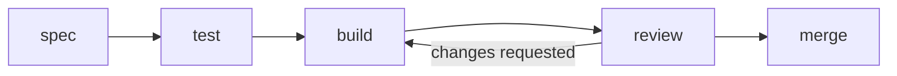

# widgetd process

widgetd runs the `sw-development` workflow: every change goes spec, test, build, review, merge.

## Where the documents live

| Path                | Role                          |
| ------------------- | ----------------------------- |
| `.agents/policy.md` | settings every workflow obeys |

## Who decides

The owner decides gates, merge rights, and the workflow itself. An agent may change code, tests, and
docs inside a change request. An agent proposes process changes and never applies them.

## Diagram

