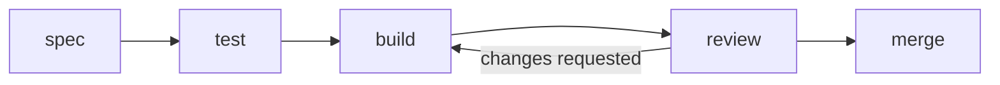

# widgetd process

widgetd runs the `sw-development` procedure: every change goes spec, test, build, review, merge.
The procedure lives in [`.agents/procedures/sw-development.md`](../.agents/procedures/sw-development.md).

## Where the documents live

| Path                                   | Role                             |
| -------------------------------------- | -------------------------------- |
| `.agents/policy.md`                    | rules every procedure obeys      |
| `.agents/procedures/sw-development.md` | the steps and gates              |
| `.agents/charter.md`                   | what the project is for          |
| `.agents/iterations/`                  | record of changes to the process |

## Who decides

The owner decides gates, merge rights, and the procedure itself. An agent may change code, tests, and
docs inside a change request. An agent proposes process changes and never applies them.

## Diagram

## Changes to the process

See [`.agents/iterations/`](../.agents/iterations/) for the record of changes.
