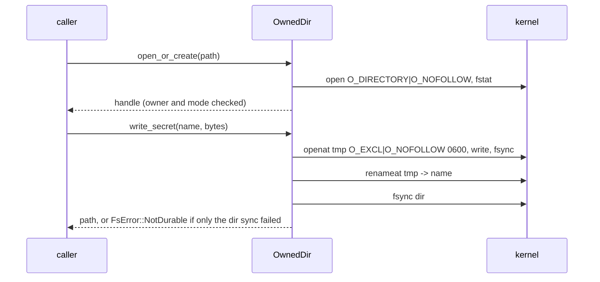

# sandy-fsutil

## Purpose

Security-sensitive filesystem primitives every sandy crate shares: the owned staging base under the
OS temp dir, symlink-safe opens beneath a host path, and the one `0600` writer for staged secrets.

## Structure

| Module    | Role                                                              |
| --------- | ----------------------------------------------------------------- |
| `staging` | create, validate and sweep the sandy staging base                 |
| `beneath` | open a host path without following a symlink at or below its leaf |
| `secret`  | `OwnedDir` handle and the `0600` secret writer (INV-1)            |
| `lib.rs`  | re-exports, `FsError`, `current_uid`, `fsync_dir`                 |

## Public API

| Item                                                  | What it does                                                              |
| ----------------------------------------------------- | ------------------------------------------------------------------------- |
| `OwnedDir::{open, open_or_create, open_matching}`     | open a staging dir, validated as this user's and not group/world-writable |
| `OwnedDir::write_secret`                              | write bytes as a `0600` file via temp, rename and dir sync                |
| `private_staging_dir`                                 | new `0700` `<prefix>-<random>` dir under the staging base                 |
| `ensure_sandy_staging_base`, `ensure_staging_base_in` | create or validate the staging base                                       |
| `sweep_stale_staging_dirs`                            | remove aged staging dirs matching `STALE_STAGING_PREFIXES`                |
| `Beneath`, `Entries`, `EntryKind`                     | handle-relative opens and listing that refuse symlinks                    |
| `FsError`                                             | `Io`, `NotDurable`, `Unsafe`                                              |
| `current_uid`, `fsync_dir`                            | real uid for receipts; fsync a directory                                  |

## Interactions

Reads and writes the OS temp dir (the staging base) and host paths handed in by callers. Calls the
kernel through `rustix` (`openat`, `mkdirat`, `renameat`, `fstat`). No network, no processes.

## Flow

## Decisions

- **Work through directory handles, never a re-resolved path.** A path swapped after the check
  cannot redirect a write, and a planted symlink is never followed.
- **`NotDurable` is its own error.** The file is already in place when the dir sync fails, so a
  caller can tell it from a failure before the rename (#196).
- **Expose `current_uid`.** The CLI supervisor reads the uid without its own `libc` or `rustix`
  dependency (#361).
