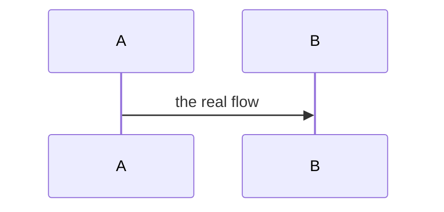

# PROJECT — spec

The as-built behavior, one section per subsystem. Write it only if the project passed the opt-in test
in `contract.md` (real runtime behavior, a protocol, stateful subsystems, non-obvious
failure/recovery). Each subsystem states its decisions and the tests that verify them, positive and
adversarial, and carries a diagram.

## Subsystem: NAME

What it does and its boundary.

**Decisions.** The load-bearing choices here, each with the invariant it turns on. Full rationale
goes in the matching ADR under `decisions/`; link it.

**Tests.** How it is verified.

- Positive: the behavior that must hold.
- Adversarial: what would prove it wrong — the input or state that would break the invariant if the
  decision were violated. Not happy-path.

## Subsystem: NAME

Repeat per subsystem.
