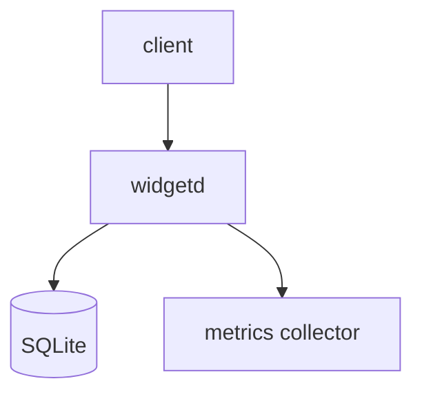

# widgetd — overview

widgetd ingests widget events over HTTP and writes them to a local store. It talks to an
upstream metrics collector and a SQLite database.

## Layout

| Path    | Role                     |
| ------- | ------------------------ |
| `src/`  | daemon and HTTP handlers |
| `docs/` | repo documentation       |

## Stack

Rust, axum for HTTP, SQLite via rusqlite. Built with cargo.

## Build, run, deploy

`make build`, `make run`. Deploys as a single static binary to the fleet.

## Diagram

## Pointers

- Decisions: [`decisions/`](decisions/)
- Deep spec: [`spec.md`](spec.md)
