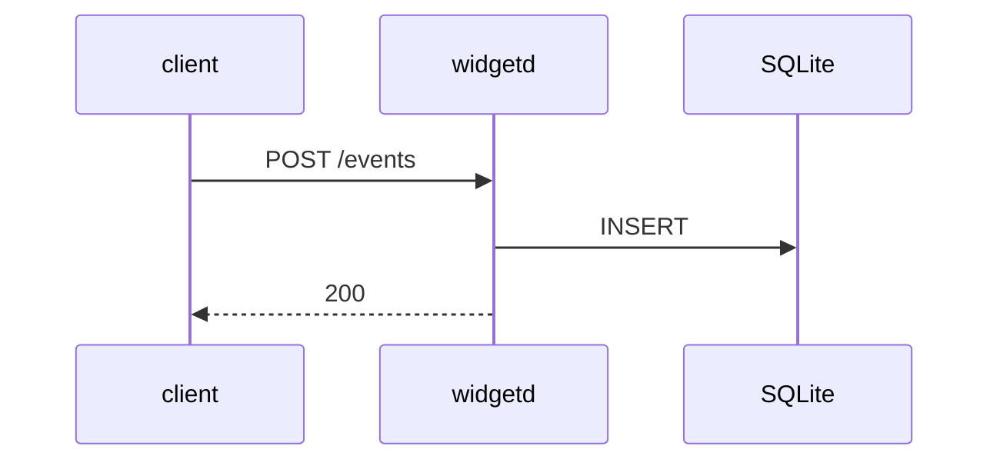

# widgetd — spec

## Subsystem: ingest

Accepts widget events on `POST /events`, validates them, and appends to the store.

**Decisions.** Events are written synchronously before the response, so a 200 means durable
(see [`decisions/use-sqlite.md`](decisions/use-sqlite.md)).

**Tests.**

- Positive: a valid event returns 200 and is present on the next read.
- Adversarial: a malformed body returns 400 and leaves the store unchanged.

