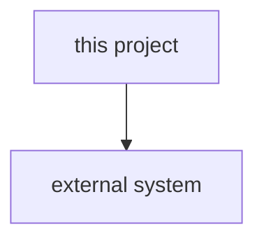

# PROJECT overview

One paragraph: what this project is and does, in the present tense. Name the external systems it
talks to. If you are skipping the deep spec, say so in one line here: "no deep spec: REASON".

## Layout

<!-- A table, not a wall of text. One line per top-level dir. -->

| Path   | Role          |
| ------ | ------------- |
| `dir/` | what it holds |

## Stack

The language(s), framework(s), build tool, and anything load-bearing a newcomer would not guess.

## Build, run, deploy

The actual commands, and where it deploys. Keep it to what someone needs to get going.

## Diagram

Mandatory: at least a context or component view. Pick the form that fits (see `diagrams.md`); seed
the component view from the code graph for a code project.

## Pointers

- Decisions: [`decisions/`](decisions/)
- Deep spec (if any): [`spec.md`](spec.md)
- Any deeper or generated docs, linked (API docs, design notes).
